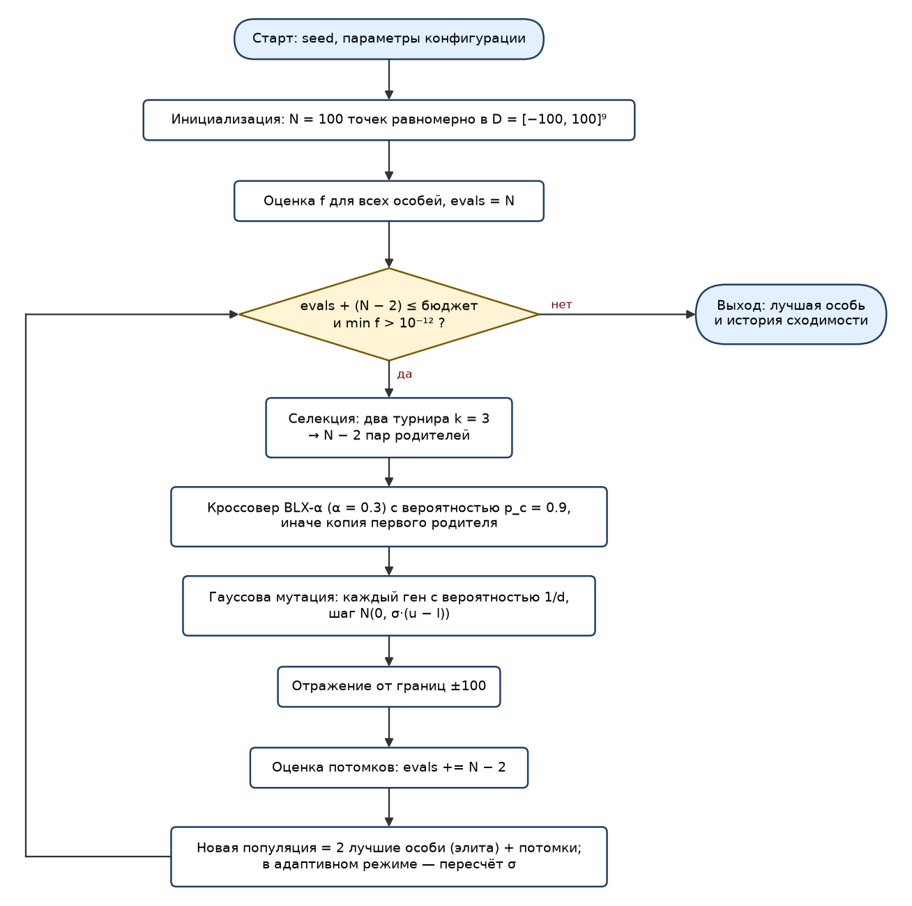
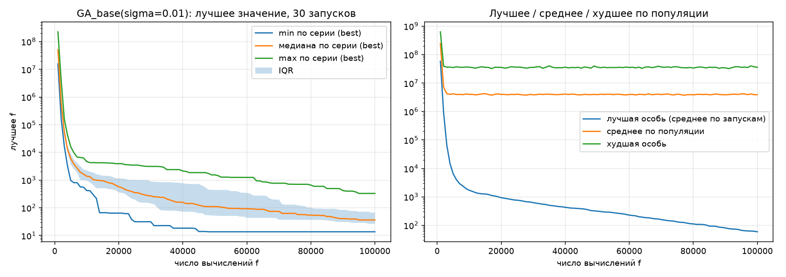
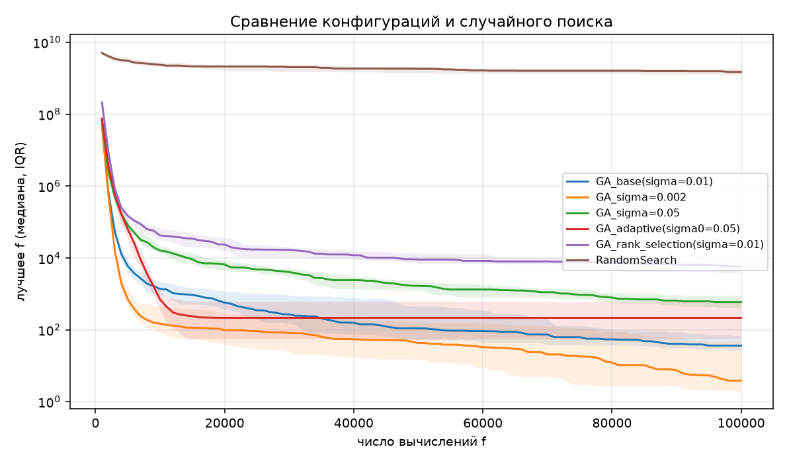
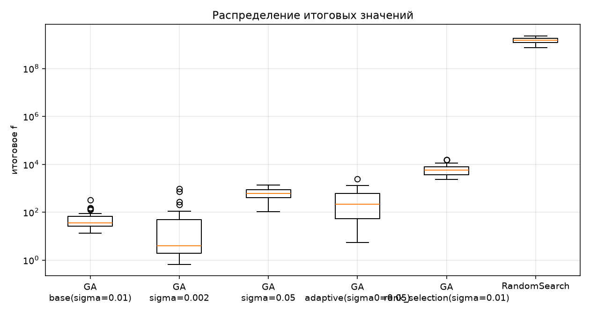

# Отчёт по лабораторной работе №1
**Дисциплина:** «Эволюционное программирование и генетические алгоритмы», группа Б24-527, N = 15, вариант V = 16.
**Выполнил:** Малышев Кирилл Борисович, группа Б24-527

## 1. Постановка и вариант
Q = 2, Y = 26: V = 1 + ((17·15 + 7·2 + 26) mod 20) = 1 + (295 mod 20) = 16. Размерность d = 5 + (16 mod 6) = **9**.

Функция «изогнутая сигара»:  f(x) = x₁² + 10⁶ · Σ_{i=2..9} xᵢ²,  область D = [−100, 100]⁹.
Требуется min f на D. Теоретический минимум: f* = 0 в x* = (0,…,0) (f ≥ 0, равенство только в нуле).

## 2. Пространство решений, целевая функция, ограничения
Пространство — гиперкуб D ⊂ ℝ⁹; единственные ограничения — границы xᵢ ∈ [−100, 100] (обработка отражением).
Целевая функция унимодальна и выпукла, но очень плохо обусловлена: число обусловленности гессиана 10⁶.

## 3. Представление особи
Вещественное кодирование: генотип = фенотип = (x₁,…,x₉), декодирования нет. Инициализация — равномерная в D.

## 4. Алгоритм и параметры
Поколенческий ГА с элитизмом. Блок-схема:

*Рисунок 1 — блок-схема генетического алгоритма*

| Параметр | Значение (база) |
|---|---|
| Размер популяции | 100 |
| Бюджет | 100 000 вычислений f (≈ 1020 поколений) |
| Селекция | турнир, k = 3 |
| Кроссовер | BLX-α, α = 0.3, p_c = 0.9 |
| Мутация | гауссова, на ген с вероятностью 1/d, σ = 0.01·(u−l) = 2.0 |
| Границы | отражение |
| Элитизм | 2 лучшие особи переходят без изменений |
| Остановка | исчерпан бюджет либо f < 10⁻¹² |
| Seed | 1000 + k, k = 0..29 |

Для сравнения реализованы: σ = 0.002 и 0.05 (только масштаб мутации меняется), ранговая линейная селекция (s = 1.8),
адаптация масштаба мутации (σ·1.05 при улучшении лучшего значения, σ·0.9 при стагнации, σ ∈ [10⁻¹², 0.2]), случайный поиск.

## 5. Обоснование операторов
Турнир даёт управляемое давление отбора без масштабирования f (значения f различаются на много порядков, рулетка была бы непригодна).
BLX-α расширяет интервал между родителями, не давая популяции сжаться слишком рано. Гауссова мутация даёт мелкие локальные шаги.
Отражение сохраняет распределение мутации у границы лучше, чем обрезка (которая накапливает особи на границе). Элитизм гарантирует монотонность лучшего значения.

## 6. Результаты (30 независимых запусков, бюджет 100 000 вычислений f)
| Конфигурация | Лучший | Среднее | Медиана | Ст. откл. | Худший |
|---|---|---|---|---|---|
| **GA база (σ=0.01)** | 13.6 | 59.2 | 36.4 | 62.0 | 329.6 |
| GA σ=0.002 | 0.668 | 87.8 | 3.88 | 215 | 940.7 |
| GA σ=0.05 | 104.9 | 647.1 | 595.7 | 339.9 | 1366 |
| GA адаптивный (σ₀=0.05) | 5.48 | 428.3 | 216.6 | 552.7 | 2438 |
| GA ранговая селекция (σ=0.01) | 2353 | 6596 | 5791 | 3838 | 15395 |
| Случайный поиск | 7.30·10⁸ | 1.49·10⁹ | 1.50·10⁹ | 4.25·10⁸ | 2.31·10⁹ |

Время одного запуска ГА ≈ 0.18 с (ранговая селекция ≈ 0.26 с, случайный поиск ≈ 0.007 с; столбец `mean_time_s` в `results/summary.csv`), число вычислений f ≈ 99 962 (последнее неполное поколение не запускается). Доля допустимых решений 100 % (границы всегда соблюдены).
Ни один запуск не достиг f < 10⁻²; только σ=0.002 дала f < 1 (1 запуск из 30).

*Рисунок 2 — сходимость базовой конфигурации (σ = 0.01, 30 запусков): слева — лучшее значение f по серии (минимум, медиана, максимум, межквартильный размах), справа — лучшая, средняя и худшая особь популяции (среднее по запускам)*

*Рисунок 3 — сравнение конфигураций и случайного поиска: медиана и межквартильный размах лучшего f по 30 запускам*

*Рисунок 4 — распределение итоговых значений f по 30 запускам каждой конфигурации*

Статистическая значимость (двусторонний тест Манна—Уитни, база против остальных; считается в `run_experiments.py`, результат в `results/mannwhitney.csv`):
σ=0.002 p=0.0017; σ=0.05 p≈1·10⁻¹⁰; адаптивный p=0.0007; ранговая p≈3·10⁻¹¹; случайный поиск p≈3·10⁻¹¹.

## 7. Выводы
1. **ГА против случайного поиска.** При том же бюджете ГА лучше на 7–8 порядков по медиане (36 против 1.5·10⁹). Случайная точка в D даёт f ≈ 10⁹–10¹⁰: вероятность попасть в окрестность нуля в ℝ⁹ исчезающе мала, а случайный поиск не использует информацию о предыдущих точках.
2. **Масштаб мутации — главный фактор** (меняется только σ): σ=0.05 → медиана 596; σ=0.01 → 36; σ=0.002 → 3.9. Механизм виден на рисунке 2 справа: среднее f по популяции весь прогон держится около 4·10⁶, хотя лучшее значение падает до десятков. Причина — мутация с вероятностью 1/d затрагивает хотя бы одну из 8 «жёстких» координат у 1 − (8/9)⁸ ≈ 61 % потомков, а шаг σ·(u−l) = 2.0 добавляет к f порядка 10⁶·2² = 4·10⁶. Такие потомки заведомо хуже родителей, и их вычисления f тратятся впустую; итоговая точность (|xᵢ| ~ 10⁻³ по x₂..x₉, что намного меньше шага мутации) достигается в основном за счёт BLX-α, который сжимает популяцию вокруг лучших точек. Чем меньше σ, тем меньше разрушительных мутаций и тем больше бюджета идёт на полезный поиск. Меньшая σ точнее, но у неё больше разброс (std 215, худший 941): при мелких шагах сходимость по слабой координате x₁ идёт медленно.
3. **Ранговая селекция** с принятой настройкой (s=1.8, σ=0.01) оказалась хуже турнира k=3 на 2 порядка: давление отбора слабее, популяция дольше остаётся широкой. Вывод относится к выбранным параметрам, а не ко всем конфигурациям рангового отбора.
4. **Адаптация σ** (доп. задание) в моей простой реализации улучшила σ=0.05 (медиана 217 против 596), но не превзошла хорошо подобранную малую фиксированную σ: правило «стагнация → ×0.9» схлопывает σ после ~15 000 вычислений (кривая на рисунке 3 выходит на плато), т.е. наблюдается преждевременная сходимость. Улучшение — правило 1/5 по успешности потомков или самоадаптивная σ на особь.
5. **Почему функция сложна.** Вытянутая долина (10⁶ в обусловленности) делает x₂..x₉ «жёсткими» и x₁ «пологой». Отбор гонит популяцию вдоль 8 жёстких направлений, а по x₁ остаётся ошибка (в базовой серии медиана |x₁| ≈ 0.12, максимум ≈ 17; вклад x₁² мал, но не нулевой). Покоординатная мутация с одним σ не знает о разном масштабе осей; методы с ковариационной адаптацией (CMA-ES) решают это принципиально лучше. Простой локальный поиск с изотропным шагом также вынужден использовать шаг, подобранный под жёсткие оси, и медленно спускается по пологой.

## 8. Достаточно ли качество результата?
Для данной задачи результат **приемлем, но не отличен**. Относительно области (f ~ 10¹⁰ при старте) снижение на 8–9 порядков (медиана 36, до 0.7 в лучшем запуске) — значимое, а метод заметно лучше baseline. Но истинный минимум 0 известен, и абсолютная ошибка f ≈ 10¹–10² (по x₂..x₉ около 10⁻³, по x₁ в отдельных запусках до десятков) не доведена до машинной точности — это недостаточно для задачи, где требуется точный оптимум. Причины — фиксированный масштаб мутации и неучёт неоднородности осей; для устранения предложены адаптация шага и ковариационные методы. Выводы основаны на 30 запусках с шагом seed=1 и непараметрическом тесте, но настроены на один бюджет и размерность.

## 9. Воспроизведение
`python run_experiments.py --runs 30 --seed0 1000 --budget 100000`
