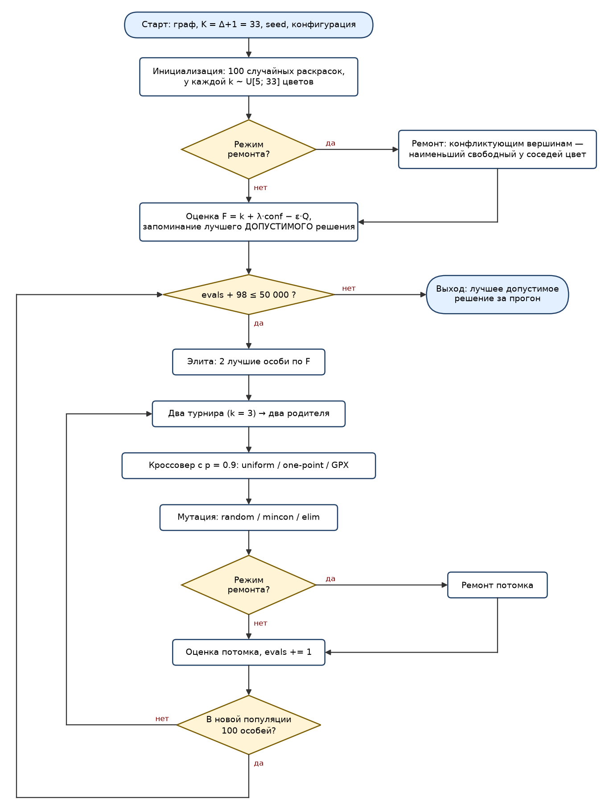
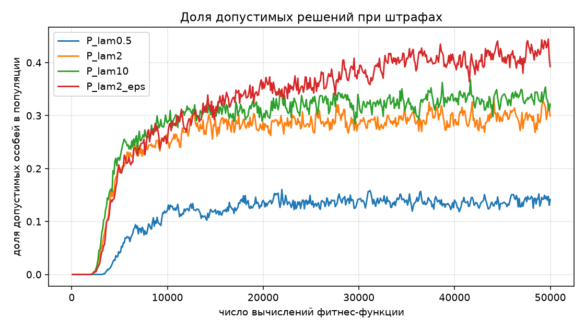
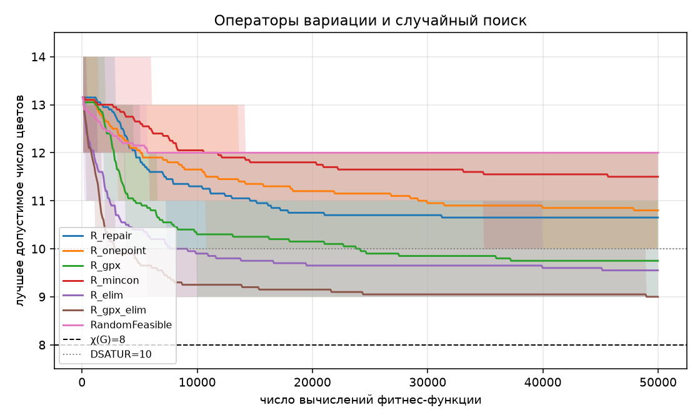
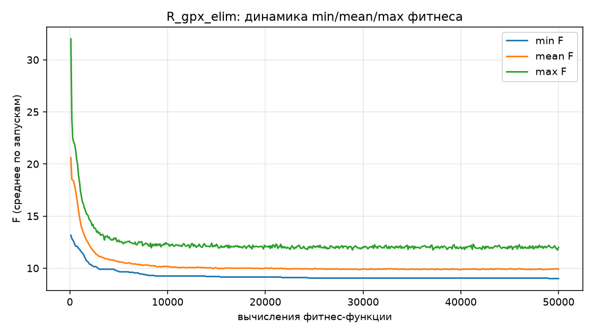
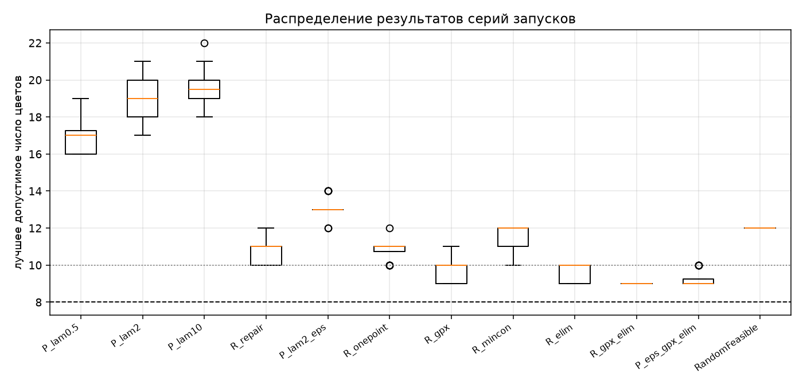
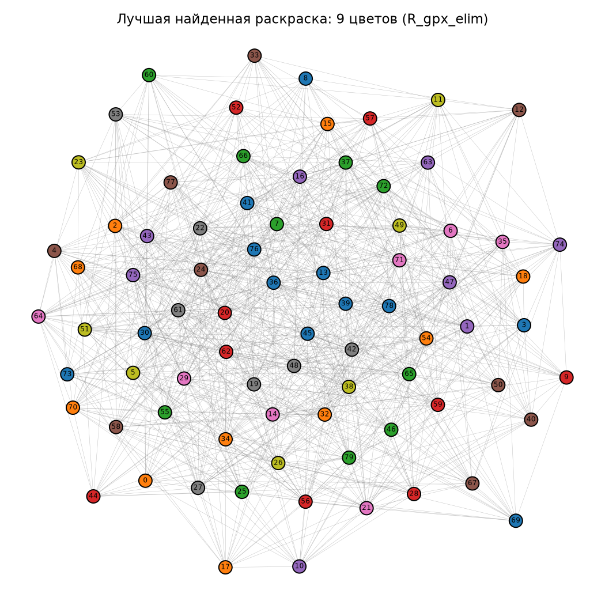

# Отчёт по лабораторной работе №2
**Дисциплина:** «Эволюционное программирование и генетические алгоритмы» (МИФИ, Душкин Р. В.)
**Выполнил:** Малышев Кирилл Борисович, группа Б24-527
**Группа Б24-527 (Q=2), N=15, Y=26 → V = 1 + ((17·15 + 7·2 + 26) mod 20) = 16.**
**Задача:** раскраска графа с минимизацией числа цветов и штрафом за конфликты; представление — вектор целых чисел.

## 1. Постановка и данные
Дан неориентированный граф G=(V,E). Нужно назначить вершинам цвета так, чтобы концы каждого ребра имели разные цвета, а число использованных цветов было минимальным.

Данные синтетические: случайный граф Эрдёша—Реньи G(n=80, p=0,3), `numpy.random.default_rng(2026)`, файлы `data/graph.json`, `data/graph_edges.csv`. Параметры: 925 рёбер, степени 17…32 (средняя 23,1), плотность 0,293 (требование ≥20 вершин выполнено).

Ориентиры: клика размера 5 (нижняя оценка), DSATUR — 10 цветов, **точный перебор (DSATUR branch&bound, 105 254 узла) доказал χ(G)=8**. Это единственный строго доказанный факт; всё остальное — экспериментальные результаты.

## 2. Формализация
- Пространство решений: c ∈ {0,…,K−1}^n, K = Δ+1 = 33 (при K ≥ Δ+1 допустимая раскраска существует всегда, жадный ремонт не может «застрять»).
- Ограничения: c[u] ≠ c[v] для всех (u,v)∈E. conf(c) = число нарушенных рёбер; допустимо при conf=0.
- Цель: min k(c), k — число различных использованных цветов.
- Фитнес: **F(c) = k(c) + λ·conf(c) − ε·Σ_j s_j²/n²** (s_j — размер j-го класса). Третий член — сглаживание плато по k (ε=0 или 0,5; при ε<1 порядок по k сохраняется).

## 3. Представление
Генотип = фенотип: вектор из n целых чисел (цвет вершины). Декодирование не требуется; фенотип — разбиение вершин на цветовые классы. Кодирование отражает структуру решения, но избыточно: перестановка меток цветов не меняет решение (симметрия). Это важно для выбора кроссовера (п. 6).

## 4. Алгоритм
Генерационный ГА с элитизмом. Параметры (все конфигурации, если не сказано иное): популяция 100, лимит **50 000 вычислений фитнес-функции**, элита 2, турнирная селекция (3), вероятность кроссовера 0,9, вероятность мутации гена 0,02, инициализация — случайные раскраски k цветами, k~U[5;33]. Остановка — по лимиту вычислений: запускаются только полные поколения (100 начальных оценок + 509 поколений по 98 потомков = 49 982 вычисления), чтобы финальная популяция всегда состояла из 100 особей. Блок-схема:

*Рисунок 1 — блок-схема генетического алгоритма раскраски*

Лучшее допустимое решение отслеживается отдельно от популяции (при штрафах лучшая по F особь может быть недопустимой). Ремонт вычислений фитнеса не расходует (считается только вызов оценки), что стоит учитывать при сравнении времени.

## 5. Обработка ограничений
1. **Штраф** (`penalty`): F = k + λ·conf, λ ∈ {0,5; 2; 10}. При λ < 1 один конфликт стоит меньше одного сэкономленного цвета, поэтому минимум F может оказаться недопустимым: например, 7 цветов с 2 конфликтами дают F = 7 + 0,5·2 = 8, столько же, сколько оптимальная допустимая раскраска в 8 цветов. При λ > 1 «обмен» одного цвета на один конфликт уже невыгоден.
2. **Ремонт** (`repair`): конфликтующие вершины в случайном порядке получают наименьший цвет, свободный у всех соседей. Перекрашенная вершина не конфликтует с соседями, последующие перекраски тоже выбирают свободные цвета, поэтому на выходе всегда conf=0.

### Примеры решений (на этом графе, `results/feasibility_examples.json`)
| Решение | Цветов | Конфликтов | Допустимо |
|---|---|---|---|
| DSATUR | 10 | 0 | да |
| лучшее решение ГА | 9 | 0 | да |
| лучшее решение ГА, у одной вершины цвет заменён на цвет соседа | 9 | 3 | нет |
| случайная раскраска 6 цветами | 6 | 129 | нет |

Второй недопустимый пример показывает, почему дешёвое «мало цветов» не годится: 6 цветов лучше по k, но нарушает 129 рёбер.

## 6. Операторы и обоснование
- **Кроссовер:** uniform; one-point; **GPX** (Galinier–Hao): потомок наследует цветовые *классы* родителей (поочерёдно берётся наибольший оставшийся класс), остаток красится случайно. Обоснование: из-за симметрии меток uniform/one-point смешивают несовместимые «нумерации» цветов и разрушают хорошие классы; GPX оперирует тем, что действительно определяет качество, — разбиением.
- **Мутация:** random (перекраска гена в случайный из использованных цветов); mincon (перекраска в цвет с минимумом конфликтов, конфликтующие вершины выбираются с вероятностью 0,5); **elim** — с вероятностью 0,5 mincon, иначе устранение одного цветового класса (меньшие классы вероятнее) с перекраской его вершин в оставшиеся цвета по минимуму конфликтов. Elim напрямую уменьшает целевое k.
- Допустимость: при штрафе потомки могут быть недопустимы, это допускается и штрафуется; при ремонте допустимость восстанавливается после каждого потомка. Любой потомок синтаксически корректен (значения всегда в 0…K−1).

## 7. Результаты серий (20 независимых запусков, seed 1000–1019, бюджет 50 000 вычислений: ГА — 49 982 (только полные поколения), случайный поиск — 50 000)
Значение — лучшее допустимое число цветов за прогон. Ориентиры: χ=8, DSATUR=10.

| Конфигурация | лучш. | среднее | медиана | σ | худш. | доля доп. особей в конце | время, с |
|---|---|---|---|---|---|---|---|
| P_lam0.5 (штраф λ=0,5) | 16 | 16,90 | 17 | 0,91 | 19 | 0,14 | 3,1 |
| P_lam2 (штраф λ=2) | 17 | 19,05 | 19 | 1,05 | 21 | 0,30 | 3,2 |
| P_lam10 (штраф λ=10) | 18 | 19,70 | 19,5 | 0,98 | 22 | 0,32 | 3,2 |
| P_lam2_eps (λ=2, ε=0,5) | 12 | 13,10 | 13 | 0,55 | 14 | 0,39 | 3,2 |
| R_repair (ремонт, uniform+random) | 10 | 10,65 | 11 | 0,59 | 12 | 1,00 | 7,1 |
| R_onepoint | 10 | 10,80 | 11 | 0,52 | 12 | 1,00 | 6,7 |
| R_gpx | 9 | 9,75 | 10 | 0,55 | 11 | 1,00 | 23,7 |
| R_mincon | 10 | 11,50 | 12 | 0,69 | 12 | 1,00 | 6,6 |
| R_elim | 9 | 9,55 | 10 | 0,51 | 10 | 1,00 | 9,4 |
| **R_gpx_elim** | **9** | **9,00** | **9** | **0,00** | **9** | 1,00 | 23,8 |
| P_eps_gpx_elim | 9 | 9,25 | 9 | 0,44 | 10 | 0,58 | 22,1 |
| Случайный допустимый поиск | 12 | 12,00 | 12 | 0,00 | 12 | 1,00 | 18,1 |
| DSATUR (один детерминированный прогон) | 10 | — | — | — | — | — | <0,1 |

Во всех запусках всех конфигураций найдено хотя бы одно допустимое решение. **Ни один запуск не достиг χ=8.** Тест Манна—Уитни: `results/mannwhitney.csv`.

![Рисунок 2 — обработка ограничений: лучшее допустимое число цветов по ходу поиска, среднее и [min, max] по 20 запускам; кривые штрафных конфигураций начинаются с момента, когда найдено первое допустимое решение](figures/conv_constraints.png)

*Рисунок 2 — обработка ограничений: лучшее допустимое число цветов по ходу поиска, среднее и [min, max] по 20 запускам; кривые штрафных конфигураций начинаются с момента, когда найдено первое допустимое решение*

*Рисунок 3 — доля допустимых особей в популяции при штрафных функциях*

*Рисунок 4 — операторы вариации (с ремонтом) и случайный допустимый поиск: лучшее допустимое число цветов*

*Рисунок 5 — итоговая конфигурация R_gpx_elim: минимальный, средний и максимальный F в популяции (среднее по 20 запускам)*

*Рисунок 6 — распределение лучшего допустимого числа цветов по 20 запускам; пунктир — χ(G) = 8 и DSATUR = 10*

### Лучшее решение в предметной форме
9 цветов (итоговая конфигурация R_gpx_elim, seed см. `results/best_solutions.json`; 9 цветов дают также R_gpx, R_elim и P_eps_gpx_elim), размеры классов 12, 10, 10, 10, 9, 8, 7, 7, 7; состав классов — `results/best_coloring_table.csv`, рисунок 7. Для практики это расписание в 9 «слотов»: вершины одного цвета можно обрабатывать одновременно.

*Рисунок 7 — лучшая найденная раскраска графа G(80; 0.3) в 9 цветов*

## 8. Выводы
1. **Способ обработки ограничений определяет результат сильнее всего.** Штрафные конфигурации без сглаживания дают в среднем 16,9–19,7 цвета, ремонт — 10,65 (p<10⁻⁷ против P_lam2). Причина: при штрафе популяция тратит бюджет на недопустимые особи — первое допустимое решение появляется лишь через 2,1–7,7 тыс. вычислений (медиана по конфигурациям 2,7–4,1 тыс., рисунок 2), а в последнем поколении допустимы только 14–32 % особей (рисунок 3), — и лучшее допустимое решение «подбирается» случайно.
2. **Коэффициент штрафа.** λ=0,5 дал лучше (16,9), чем λ=2 (19,05; p=2·10⁻⁶), λ=10 статистически не отличается от λ=2 (p=0,06). То есть слабый штраф позволяет алгоритму «проходить» через недопустимую область, а сильный делает ландшафт труднопроходимым. Но этот эффект меньше, чем влияние ремонта и сглаживания.
3. **Сглаживание фитнеса** (ε=0,5) сократило результат штрафной версии с 19,05 до 13,10 (p = 3·10⁻⁸): целевая функция «число цветов» имеет огромные плато, и добавка Σs² даёт градиент к «неравным» классам, которые легче опустошить.
4. **Операторы.** One-point не лучше uniform (p=0,37). GPX улучшает (10,65→9,75, p<10⁻⁴), elim улучшает (→9,55), вместе — 9,00 с нулевым разбросом (p = 5,7·10⁻⁶ против R_gpx и p = 1,3·10⁻⁴ против R_elim). Mincon-мутация сама по себе ухудшает (11,50), вероятно, из-за быстрой потери разнообразия. Это гипотеза, которую я не проверял отдельным экспериментом.
5. **Сравнение с baseline.** Случайный допустимый поиск: 12. GA с ремонтом (10,65) и лучшая комбинация (9,0) значимо лучше (p<10⁻⁷). Наилучшая комбинация также лучше DSATUR (10) во всех 20 запусках, но стоит 50 000 оценок против одной конструктивной эвристики.

## 9. Приемлем ли результат?
**Приемлем, но не оптимален.** Лучшая конфигурация стабильно даёт 9 цветов (на 1 больше доказанного оптимума 8, на 1 меньше DSATUR), 0 из 20 запусков достигли 8. Одинаковый результат 9 во всех запусках с σ=0 говорит о сходимости к одному и тому же локальному оптимуму (устойчиво, но не глобально). Улучшение — больший бюджет, рестарты, локальный поиск типа Tabucol (меметический вариант), что выходит за рамки ЛР №2. Строго доказано только χ(G)=8; все прочие утверждения экспериментальные.

## 10. Ограничения
- Один граф; выводы о влиянии операторов могут отличаться на других графах/плотностях.
- Ремонт и мутации выполняют дополнительную работу вне счётчика вычислений фитнеса; по времени GPX-конфигурации примерно в 3,3 раза дороже uniform с ремонтом (23,7 с против 7,1 с на запуск) и в ~7 раз дороже штрафных конфигураций.
- Параметры (размер популяции, p_mut и т. д.) не подбирались, кроме сравниваемых факторов; ε и λ не оптимизировались.
